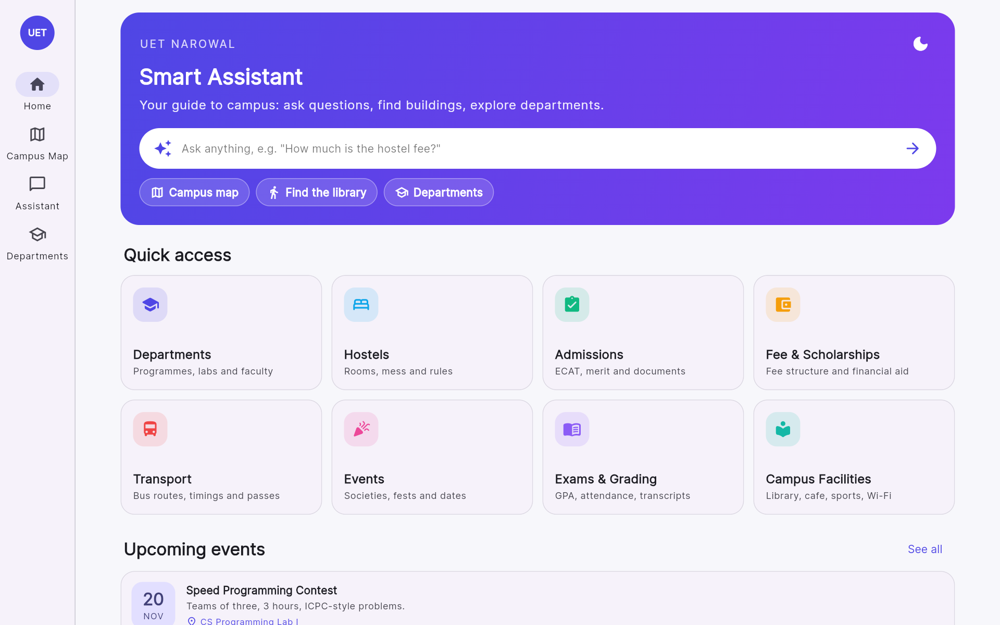
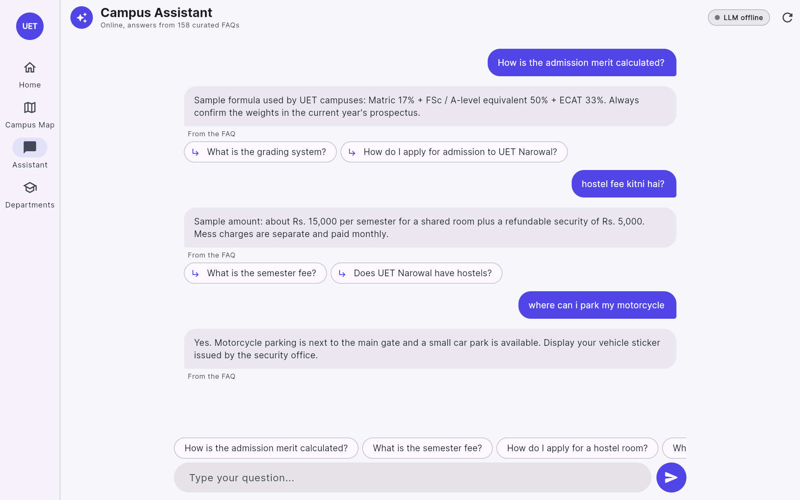
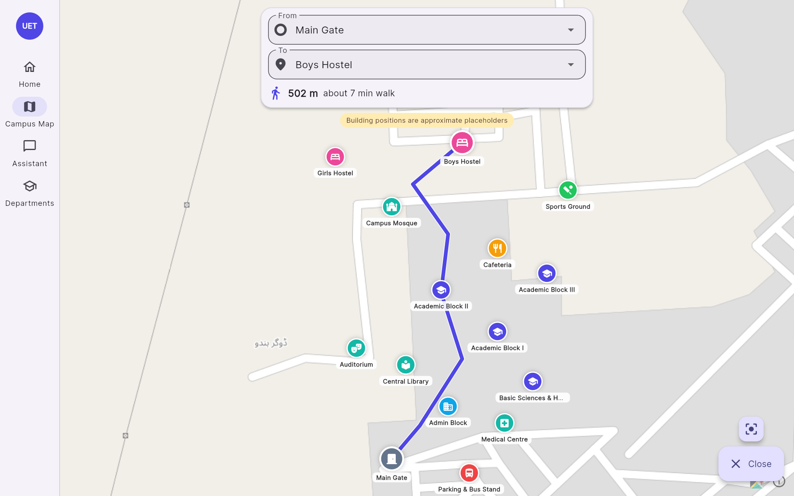
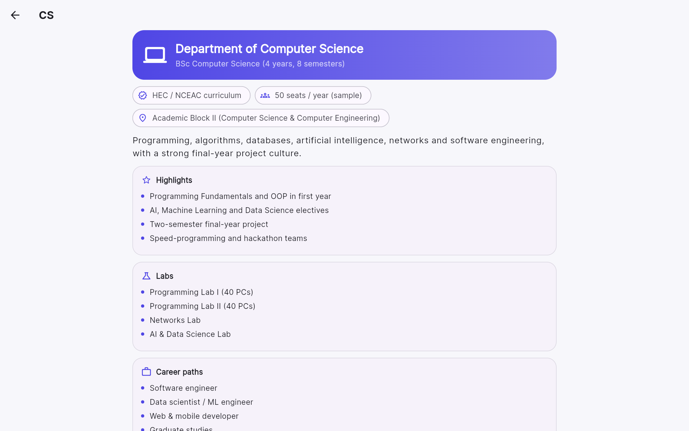

# UET Narowal Smart Assistant

**A Flutter student-guide app for freshers at UET Lahore, Narowal campus: a campus chatbot, an interactive campus map with walking directions, and department guides.**



| Assistant | Campus map with directions | Department detail |
|---|---|---|
|  |  |  |

> Student project, not an official university app. Campus-specific details in `data/` (fees, dates, contacts, building positions) are **sample data** written for the demo. Verify them with the university before relying on them.

## Features

- **Home**: quick cards for Departments, Hostels, Admissions, Fee & Scholarships, Transport, Events, Exams and Facilities. Each opens a topic page with key facts and the related FAQs.
- **Campus Assistant (chatbot)**: chat bubbles, suggested questions, typing indicator, "related questions" chips and an **LLM online / offline** badge.
  - Backend: a FastAPI service doing **retrieval over 158 curated FAQ entries** (TF-IDF, word + character n-grams), then optionally an LLM (Groq / OpenAI / Ollama) that rewrites the answer using only the retrieved entries.
  - No API key? It returns the best matching FAQ answer. Server not running? The app falls back to an on-device matcher over the bundled FAQ, so the web demo never breaks.
- **Campus Map**: OpenStreetMap via `flutter_map` (no Google key needed), colour-coded building markers, search box, info cards, and **walking directions** computed with Dijkstra over a campus walkway graph (distance + walking time).
- **Departments**: CS, EE, Computer Engineering, Mechanical, Humanities & Basic Sciences, each with programme, labs, highlights, careers, "show on map" and "ask the assistant".
- Material 3, Inter font, indigo accent, light + dark mode, responsive (bottom navigation on phones, navigation rail on wide screens).

## Architecture

```mermaid
flowchart LR
    subgraph Flutter app (web / Android / iOS)
        H[Home & topic pages] --> D[(bundled data/*.json)]
        M[Campus map<br/>flutter_map + OSM] --> D
        M --> R[Dijkstra over<br/>walkway graph]
        C[Chat screen] -->|POST /api/chat| API
        C -. server unreachable .-> L[on-device FAQ matcher]
        L --> D
    end
    subgraph FastAPI server
        API[/api/chat/] --> T[TF-IDF retrieval<br/>word 1-2 + char 3-5 grams]
        T --> F[(data/faq.json<br/>158 Q&A)]
        T -->|top-3 entries| G{LLM key set?}
        G -- yes --> LLM[LLM writes grounded answer<br/>Groq / OpenAI / Ollama]
        G -- no / error --> B[best FAQ answer]
    end
```

## Results

Retrieval is evaluated on a **held-out set of 68 hand-written paraphrased questions** (typos, Roman-Urdu words such as "kab", "kahan", short forms like "cs", "hostal") plus 6 out-of-scope questions. None of them are in the index. Run `python -m server.evaluate`; full output and the list of misses are in [docs/retrieval_results.md](docs/retrieval_results.md).

| Retriever | Top-1 | Top-3 | Out-of-scope rejected |
|---|---|---|---|
| Word TF-IDF (1-2 grams) | 75.0% | 85.3% | 2 / 6 |
| Char TF-IDF (3-5 grams) | 82.4% | 89.7% | 0 / 6 |
| **Blend 50/50 (used by the app)** | **82.4%** | **94.1%** | 1 / 6 |

Honest notes:
- The test set is small and hand-written, so treat these numbers as indicative rather than a benchmark.
- **Out-of-scope rejection is weak.** A lexical retriever matches "what is the weather in **Narowal**" to a campus question. Without an LLM, such questions can get an unrelated FAQ answer. With an LLM configured, the prompt tells it to say it is not sure when the context does not answer the question. Sentence embeddings or a classifier would be the next step.
- This is **retrieval + optional LLM**, not a fine-tuned model.

## Tech stack

Flutter 3.47 (Dart 3.13) · Material 3 · flutter_map 8 + OpenStreetMap · latlong2 · google_fonts · Python 3.12 · FastAPI · scikit-learn (TF-IDF) · OpenAI-compatible client (Groq / OpenAI / Ollama)

## Quick start

Requires Flutter 3.x and Python 3.10+.

```bash
python -m venv .venv && .venv/Scripts/pip install -r requirements.txt   # macOS/Linux: .venv/bin/pip
.venv/Scripts/python -m uvicorn server.app:app --port 8000               # chatbot API on :8000
flutter pub get
flutter run -d chrome                                                     # app (second terminal)
```

Optional LLM: copy `.env.example` to `.env` and set `LLM_API_KEY` (free Groq key). Without it the badge shows "LLM offline" and answers come straight from the FAQ.

Single-server demo: `flutter build web` then start uvicorn; the API also serves the web build at http://localhost:8000.

Tests: `flutter test` (routing) and `.venv/Scripts/python -m pytest server -q` (API).

## Editing the data

| File | What it holds |
|---|---|
| `server/build_faq.py` → `data/faq.json` | 158 FAQ entries with alternative phrasings. Edit the script and re-run it. |
| `data/faq_eval.json` | Held-out evaluation questions |
| `data/buildings.json` | Building markers and the walkway graph. **Coordinates are placeholders** around Narowal; replace them with the real campus positions. |
| `data/departments.json`, `data/events.json` | Department pages and the sample events calendar |

## Dataset & credits

- FAQ, departments, events and buildings: written for this project; general procedures (ECAT, aggregate formula, HEC/PEC rules, scholarships) follow publicly known UET / HEC practice, campus specifics are sample values.
- Map tiles © [OpenStreetMap](https://www.openstreetmap.org/copyright) contributors.

## Author

**Amna Choudhri**

Originally developed as a team university project; this version was refactored and extended by Amna Choudhri.

What this rebuild added on top of the original Flutter skeleton (navigation bar, three home cards, stub chatbot and map screens):

- Complete Material 3 app with light/dark theme and a responsive layout for web
- Home quick cards and topic pages (admissions, fees, hostels, transport, events, exams, facilities)
- Chatbot screen and the FastAPI retrieval backend over a curated 158-entry FAQ, with an optional LLM and an offline fallback
- Held-out retrieval evaluation (`server/evaluate.py`)
- OpenStreetMap campus map with search and walking directions (Dijkstra over a walkway graph)
- Department guides with detail pages
- Tests, README and setup files

## License

MIT, see [LICENSE](LICENSE).
